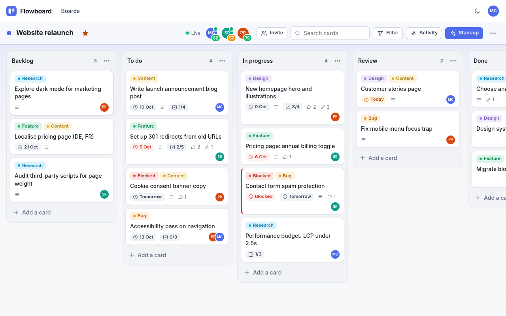
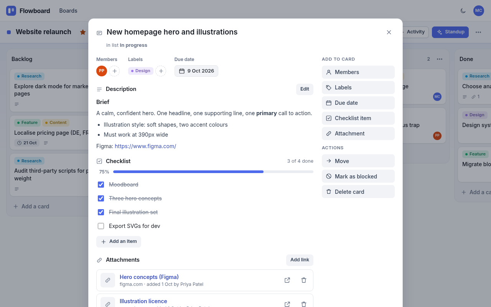
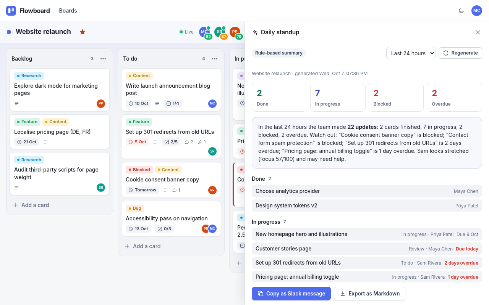
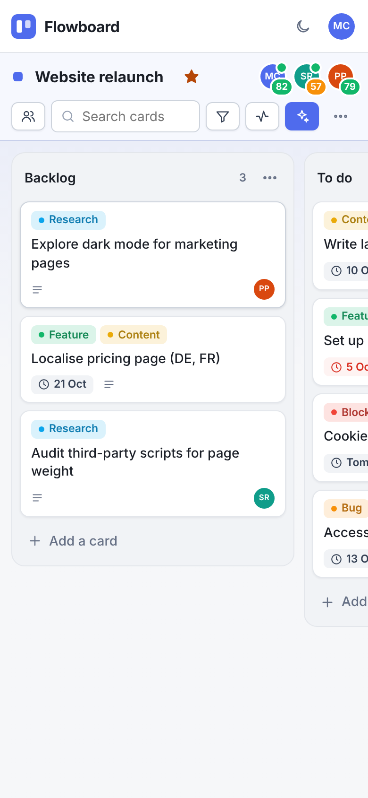

# Flowboard

A calm, Trello-style kanban board with real-time collaboration and an **AI Standup Mode** that turns the last 24 hours of board activity into a daily standup, with a focus score for every teammate.

It has **zero npm dependencies**. Everything runs on Node.js built-ins: `node:http`, `node:sqlite`, `node:crypto` and Server-Sent Events. There is no build step and nothing to `npm install`.



| Card details | AI Standup | Phone (390 px) |
|---|---|---|
|  |  |  |

A dark theme is also included ([screenshot](docs/screenshots/board-dark.png)).

---

## Quick start

### Windows (double-click)

1. Install **Node.js 24 LTS** from <https://nodejs.org>. Node 22.5 or newer also works.
2. Double-click **`start.bat`**.
3. Your browser opens at **http://localhost:3000**. If port 3000 is busy, Flowboard uses the next free port and opens that one.
4. Sign in with a demo account (below), or create your own.

`start.bat` looks for `node` on your PATH. If it can't find it there, it tries the default install folders (`%ProgramFiles%\nodejs\node.exe` and friends) and checks the version. Keep the window open while you use Flowboard and press **Ctrl+C** to stop it.

### macOS / Linux / any terminal

```bash
node server/server.js --open      # or: npm start
```

On first run, Flowboard creates `data/flowboard.db` (SQLite) and seeds the demo data. Delete the `data/` folder to start fresh.

### Demo accounts

| Name | Email | Password | Role on "Website relaunch" |
|---|---|---|---|
| Maya Chen | `maya@example.com` | `flowboard123` | Owner (also owns "Q4 planning") |
| Sam Rivera | `sam@example.com` | `flowboard123` | Member (also on "Q4 planning") |
| Priya Patel | `priya@example.com` | `flowboard123` | Member |

The sign-in page has a **Use demo account** button. To see live collaboration, open Flowboard in two different browsers (or one normal window and one private window), sign in as Maya in one and Sam in the other, and open the same board.

The seed adds a "Website relaunch" board with 5 lists, 6 labels and 16 cards. Some cards are overdue, some are blocked, and the activity is back-dated over the last 24 hours, so the standup has something to say right away. A smaller "Q4 planning" board is seeded too. Seeding only happens when the database has no users. Set `SEED=false` to start empty.

---

## Features

**Accounts**
- Sign up, sign in and sign out, with inline validation on every field.
- Passwords are hashed with salted **scrypt**.
- Sessions use random tokens. Only a SHA-256 hash of each token is stored, in an `HttpOnly`, `SameSite=Lax` cookie that lasts 30 days.
- Login and sign-up are rate-limited.

**Boards**
- Create, rename (click the name), star, change the background colour (8 calm colours) and delete. Only the owner can delete.
- **Members:** invite existing users by email. The owner can remove members, and members can leave.
- **Labels:** manage them per board (create, rename, recolour, delete), or create one straight from a card.

**Lists and cards**
- Create, rename and delete lists and cards. Composers stay open so you can add several cards in a row (Enter to add, Esc to close).
- **Drag and drop** for cards (within and between lists) and for lists, built on **Pointer Events**:
  - Mouse and pen drags start after 5 px of movement.
  - On touch screens, a **long-press** (about 0.2 s) picks a card up, so normal swipes still scroll the board.
  - Cards lift and tilt while dragged. Neighbours slide aside (FLIP animation) and the card glides into place.
  - The board auto-scrolls near the edges. Esc cancels a drag.
- The new order is saved on the server immediately, as integer positions that are renumbered on every move.
- A keyboard-friendly **Move** dialog in the card modal does the same as drag and drop (list + position). List menus have "Move left/right".

**Card details** (opens as a modal, and the card has its own URL `#/b/<board>/c/<card>`)
- Inline-editable title.
- **Markdown description** with a safe renderer: headings, bold/italic, code, lists, task lists, quotes and links. HTML is always escaped, and only `http(s)` and `mailto` links are allowed.
- Due date, with quick picks and Overdue / Due today / Complete badges.
- Labels and assignees.
- **Checklist** with a progress bar. Items can be edited inline.
- **Comments** (Markdown), each with author and time. You can delete your own; the owner can delete any.
- **Attachments as links**: URL plus an optional title, and only `http(s)` links are accepted.
- A **Blocked** flag.
- Per-card history.

**Search and filter**
- Search card titles and descriptions as you type.
- Filter by **label**, **member** (or "no members"), **due date** (overdue, due today, next 7 days, none) and **blocked**.
- A bar shows "Showing X of Y cards · Clear filters".

**Activity log**
- A side panel with every change, written in plain sentences, for example *"Sam Rivera moved 'Pricing page' from To do to In progress"*.
- Comment excerpts, links to the card, live updates as they happen, and **Load more** for older entries.

**Real-time collaboration**
- Uses Server-Sent Events: one stream per open board.
- Other people's changes appear instantly, in every tab and for every user. If you have a card modal open, it updates too.
- **Presence**: a green dot on the avatar of everyone currently viewing the board.
- A **Live / Offline** indicator. When the server comes back, the page reconnects and catches up by itself.
- If someone deletes the board or removes you from it, you are told and taken back to your boards.

**AI Standup Mode** (see below)

**Look and feel**
- Clean light theme by default, an optional **dark mode** (it remembers your choice) and one calm indigo accent.
- Soft cards with thin borders, Inter or the system UI font, and subtle motion: cards lift while dragging, lists animate when reordered, modals fade and scale in, panels slide.
- `prefers-reduced-motion` turns animation off.
- Responsive from **390 px** phones (lists snap one per screen) to wide desktops, with no horizontal page scroll.
- Keyboard accessible: focusable cards (Enter opens them), focus trapping in dialogs, Esc to close, and visible focus rings.

---

## AI Standup Mode

Click **Standup** on any board. The panel summarises the last **24 hours** (or 48 h / 7 days) of activity:

- **Done**: cards moved into a done-style list (Done, Complete, Shipped, Released…) in the window.
- **In progress**: open cards in an active list (In progress, Doing, Review, QA…) or touched in the window.
- **Blocked**: open cards with the **Blocked** flag or a label named "Blocked".
- **Overdue**: open cards past their due date, plus a **Due today** list.
- **Needs an owner**: blocked or overdue cards with no assignee.
- **By person**: one section per member, showing what they finished, are working on, are blocked on and have overdue, together with their **focus score**.
- A written summary, the counts, and links straight to each card.

**Copy as Slack message** puts Slack-formatted text on your clipboard (`*bold*`, `•` bullets and emoji section headers). **Export as Markdown** downloads `standup-<board>-<date>.md`.

### AI or rules

| | When | What you get |
|---|---|---|
| **Rule-based** (default) | No `AI_API_KEY` | The deterministic summary described above. Always available, free and instant. |
| **AI write-up** | `AI_API_KEY` set | An OpenAI-compatible model rewrites the same facts into a friendly standup with sections and suggested next steps. Focus scores and the card lists are still computed by Flowboard. |

Configure it in a `.env` file next to `start.bat` (copy `.env.example`):

```ini
AI_API_KEY=sk-...
AI_BASE_URL=https://api.openai.com/v1   # any OpenAI-compatible /chat/completions endpoint
AI_MODEL=gpt-4o-mini
```

This works with OpenAI, Azure OpenAI, OpenRouter, Groq, or a local **Ollama** / **LM Studio** server (for example `AI_BASE_URL=http://localhost:11434/v1`).

- **What is sent:** only card titles, list names, label names, member names, due dates and counts. Descriptions, comments, emails and links are never sent.
- **What the AI's text can do:** it goes through the same safe Markdown renderer as everything else, so it can't inject HTML.
- **If the AI fails** (bad key, timeout after 25 s, or an error), Flowboard falls back to the rule-based summary and shows why.

### Focus score (0–100)

Shown as a coloured badge on each member's avatar in the board header, and as a gauge in the standup.

```
score = 100 − 8 × max(0, open − 3)        # work in progress beyond 3 cards
            − 15 × overdue                # deadline pressure
            − 5 × max(0, touched − 3)     # context switching beyond 3 cards
clamped to 0–100
```

- **open**: cards assigned to the person that are not in a done-style list.
- **overdue**: those open cards that are past their due date.
- **touched**: the number of *different* cards the person changed on this board in the last 24 hours.

| Score | Level | Badge |
|---|---|---|
| 75–100 | Focused | green |
| 50–74 | Stretched | amber |
| 0–49 | Overloaded | red |

The idea: up to three cards in flight and up to three cards touched per day is healthy, so it costs nothing. Every overdue card costs the most. The formula lives in `server/standup.js` (`FOCUS` constants) and is unit-tested. Right after seeding, Maya scores 82, Sam 57 and Priya 79. The "touched" part relaxes as the back-dated activity ages out of the 24-hour window.

---

## Configuration

All settings are optional. Put them in `.env` (see `.env.example`) or set them as environment variables.

| Variable | Default | Meaning |
|---|---|---|
| `PORT` | `3000` | Port. If it is not set and 3000 is busy, the next free port (up to 3020) is used. `--port 3001` also works. |
| `HOST` | `127.0.0.1` | Interface to listen on. The default keeps Flowboard private to this computer. |
| `DATA_DIR` | `data` | Folder for `flowboard.db`. |
| `SEED` | `true` | Create the demo users and boards on first run. |
| `SESSION_DAYS` | `30` | How long a sign-in lasts. |
| `AI_API_KEY`, `AI_BASE_URL`, `AI_MODEL`, `AI_TIMEOUT_MS` | – | AI Standup Mode (see above). |
| `COOKIE_SECURE` | `auto` | Mark cookies `Secure` when the request is HTTPS. |

`render.yaml` describes an optional future deployment to Render (web service + persistent disk). **Nothing has been deployed.**

---

## Tests

```bash
npm test            # node --test: unit + API + realtime + AI (mock server) + persistence. No dependencies.
npm run test:e2e    # Playwright browser tests (optional; Playwright is not a dependency)
```

**`npm test`** (30 tests, about 12 s) covers:
- the Markdown XSS cases, validation rules, the focus formula, and the standup Markdown and Slack output;
- every API route, permissions between owner, member and outsider, and CSRF rejection;
- SSE change, presence, removal and deletion events;
- AI mode against a mock OpenAI server, including what is sent and the fallback on error and timeout;
- restart persistence, seeding, `SEED=false`, port fallback and starting from a fresh copy.

**`npm run test:e2e`** (12 tests) covers:
- sign-up and sign-in with inline validation, and board CRUD;
- drag and drop with the mouse and with touch long-press, and order persistence;
- card details, including an XSS attempt, and search and filters;
- the standup panel, including the Slack clipboard and Markdown download;
- **real-time sync between two browser contexts**;
- 390 px and 1280 px layouts with no horizontal scroll, dark mode, and reduced motion;
- **no console errors**, **persistence across a server restart**, and a **fresh-copy start**.

To run the e2e tests once:

```bash
npm install --no-save playwright
npx playwright install chromium
npm run test:e2e
```

---

## Project structure

```
flowboard/
├─ start.bat              Windows launcher (finds Node, opens the browser)
├─ package.json           start / test scripts, no dependencies
├─ .env.example           every setting, documented
├─ render.yaml            optional Render blueprint (not deployed)
├─ server/
│  ├─ server.js           entry point: version check, HTTP server, port fallback, shutdown
│  ├─ config.js           .env + environment
│  ├─ http.js             tiny router, JSON bodies, static files, CSP and security headers, rate limits
│  ├─ db.js / schema.sql  node:sqlite (WAL, foreign keys, transactions)
│  ├─ engine.js           all business rules and permissions; every change is logged as activity
│  ├─ standup.js          standup report, focus score, Markdown and Slack output
│  ├─ ai.js               optional OpenAI-compatible write-up
│  ├─ realtime.js         Server-Sent Events hub (changes and presence)
│  ├─ seed.js             demo users and boards
│  └─ routes/             auth, boards, lists, cards, meta
├─ public/
│  ├─ index.html
│  ├─ css/styles.css      design tokens, light and dark themes, responsive, reduced motion
│  └─ js/
│     ├─ shared/          validation, safe Markdown and activity sentences (used by browser AND server)
│     ├─ core/            helpers, API client, theme bootstrap
│     ├─ ui/              icons, toasts, modal, popover, forms
│     ├─ board/           store, realtime client, drag and drop, filters
│     ├─ views/           auth, home, board, card modal, activity panel, standup panel
│     └─ app.js           router, account menu, theme toggle
├─ tests/                 node --test suites + e2e/ (Playwright)
└─ docs/screenshots/
```

### API overview

All endpoints are JSON under `/api`. Every mutating request must be same-origin and `Content-Type: application/json`; anything else gets 403 or 415.

| Area | Endpoints |
|---|---|
| Auth | `GET /me` · `POST /auth/signup` · `POST /auth/signin` · `POST /auth/signout` |
| Boards | `GET/POST /boards` · `GET/PATCH/DELETE /boards/:id` · `PUT /boards/:id/star` |
| Members and labels | `POST /boards/:id/members` · `DELETE /boards/:id/members/:userId` · `POST /boards/:id/labels` · `PATCH/DELETE /labels/:id` |
| Lists | `POST /boards/:id/lists` · `PATCH/DELETE /lists/:id` · `POST /lists/:id/move` |
| Cards | `POST /lists/:id/cards` · `GET/PATCH/DELETE /cards/:id` · `POST /cards/:id/move` · `PUT/DELETE /cards/:id/labels/:labelId` · `PUT/DELETE /cards/:id/assignees/:userId` |
| Card content | `POST /cards/:id/checklist` · `PATCH/DELETE /checklist/:id` · `POST /cards/:id/comments` · `DELETE /comments/:id` · `POST /cards/:id/attachments` · `DELETE /attachments/:id` |
| Activity and standup | `GET /boards/:id/activity?before=&limit=` · `GET /boards/:id/standup?hours=24` |
| Live | `GET /boards/:id/events` (Server-Sent Events) |
| Meta | `GET /health` · `GET /config` |

---

## How I built it

- **Constraints first.** The target was a Windows laptop with only Node.js 24, no Python and ideally nothing to install. So the whole stack is Node built-ins:
  - `node:sqlite`'s `DatabaseSync` for storage;
  - `node:crypto` scrypt for passwords;
  - `node:http` with a ~150-line router.

  On Node 22.5–22.12, the server re-launches itself with `--experimental-sqlite`, so older installs still work.
- **One engine, many doors.** Every change goes through a single `change(actor, board, fn)` helper in `engine.js`. In one transaction it applies the change, bumps the board version and writes activity rows (with name snapshots, so history stays readable after renames). It then publishes a realtime event. The activity log, the standup, the focus score and live sync all come from that one stream of facts.
- **Realtime without WebSockets.** Server-Sent Events are plain HTTP and reconnect automatically. Each tab sends an `X-Client-Id`, so it can ignore the echo of its own changes, and other tabs simply re-fetch the board. That is simple and always consistent, and a board this size is a few KB.
- **Shared code.** Validation rules, the Markdown renderer and the activity sentences are small UMD files. The browser and the server load the same ones, so inline form errors match server errors exactly, and the standup prints the same sentences as the activity panel.
- **Security by default.**
  - Escape-first Markdown and a strict Content-Security-Policy (no inline scripts).
  - Same-origin plus JSON-only checks on mutations (CSRF protection).
  - Hashed session tokens, rate limits, and permission checks on every route.
  - Outsiders get 404s, not 403s, so board ids don't leak.
- **Drag and drop by hand.** HTML5 drag and drop doesn't work on touch, so `dnd.js` uses Pointer Events. The original card stays in the list as a placeholder while a clone follows the pointer, and FLIP animations move the neighbours. Touch needs a long-press, with a non-passive `touchmove` guard, so scrolling still feels native.
- **The standup is deterministic first, AI second.** The rule-based report is always built. The AI only rewrites those verified facts, and its failures degrade gracefully. That makes the feature testable and safe to demo offline.
- **Tested like a user.** The `node --test` suites drive the real server over HTTP. The Playwright suite uses real browsers: two contexts for live sync, real touch events for long-press drag, and a server restart in the middle of a session.

---

## Limitations

- **Single server process.** Live updates are broadcast in memory, so running several instances behind a load balancer would need a shared pub/sub. SQLite also suits one machine.
- **Attachments are links only.** There are no file uploads.
- **No email.** Invites only work for people who already have an account; there are no invitation emails and no password reset. Anyone who can reach the server can sign up. By default it only listens on `127.0.0.1`.
- **Conflicts are last-write-wins.** Two people editing the same card description at the same moment: the last save wins (everyone sees the result live).
- **The focus score is a heuristic.** It is a conversation starter, not a performance metric.
- **One action at a time.** There is no undo, and no archive (deletes are permanent after a confirmation).
- **AI output quality** depends on the model you configure. Without a key, the summary is rule-based.
- **`node:sqlite` is still marked experimental** in Node 22 (Flowboard hides the warning). Node 24 LTS is recommended.

## License

MIT (see [LICENSE](LICENSE)). The demo data uses fictional people and `example.com` addresses.
